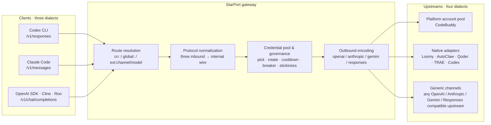

<h1 align="center">StarPort</h1>

<p align="center">
  <b>A multi-platform credential gateway for AI coding tools — one endpoint, three protocols, many backends</b><br>
  OpenAI Chat Completions · Anthropic Messages · OpenAI Responses inbound ｜ credential pools · protocol translation · routing · usage governance
</p>

<p align="center">
  English ｜ <a href="README.md">简体中文</a>
</p>

<p align="center">
  
  
  
  
  
</p>

---

## 30-second overview

| Aspect | Summary |
|---|---|
| **What** | A self-hosted gateway that translates the three protocols clients speak into the four protocols upstreams speak, and puts credentials from many platforms into one governed pool |
| **Why** | Protocol mismatch between tools and supply, plus scattered credentials. Switching backends is one `model` change — no reinstall, no code change, no second key |
| **Coverage** | 3 inbound protocols × 4 outbound protocols × 8 native platforms + any custom upstream |
| **Scale** | 282 Go files / ~88k LOC · 142 test files · CI runs `go vet` + `go test` · MIT |
| **Not** | No API resale, no multi-tenant SaaS, no account sharing |

## Why this exists

The **protocol surface** of AI coding tools is fragmenting. Codex CLI speaks the OpenAI Responses API. Claude Code speaks the Anthropic Messages API. Almost every SDK, IDE extension, and in-house script speaks Chat Completions. Meanwhile the **supply side** is scattered across platforms that each have their own login flow, quota model, rate-limit rules, and credential format.

The result: developers maintain N client configs, N credential sets, and N usage dashboards — and re-wire everything each time they switch tools. Comparing two backends on the same task means editing environment variables back and forth.

StarPort collapses this into two layers:

- **Protocol layer** — three inbound surfaces (Chat Completions / Messages / Responses) folded into one internal wire, then re-encoded into four outbound protocols. Clients can speak any dialect; upstreams can too.
- **Credential layer** — accounts from many platforms share one credential pool with health state, cooldown, rotation, and accounting, behind a single routing and quota view.

In one sentence: **a small but load-bearing connector in the AI developer toolchain.** It does not produce models — it makes tools and supply line up.

## What it is / what it is not

| It is | It is not |
|---|---|
| A self-hosted, single-binary protocol gateway | An API resale / billing middleman |
| A bidirectional translator across three inbound protocols | A multi-tenant SaaS |
| A credential pool and governance layer for multiple platforms | A model provider |
| An observability and ops tool with a web panel | An account-sharing pool |

Deliberately narrow: loopback-only by default, no telemetry, credentials stay in local files (`0600`). The target scenario is *one developer managing their own credentials*.

## Why it matters to the ecosystem (and is not another aggregator)

An aggregator funnels traffic to one vendor; middleware solves "anyone can connect". Three reusable public assets are what this repo actually gives away:

1. **Cross-platform contract docs**: [docs/PLATFORMS.md](docs/PLATFORMS.md) turns the auth-header shapes, error-code semantics, streaming boundaries and known pitfalls of eight platforms into one comparable table. This knowledge normally lives in private notes; a systematic public version is rare.
2. **A protocol-conformance test pattern**: table-driven assertions across three inbound × four outbound × each adapter, plus a parity gate that fails the build when the panel and the backend platform registry drift. A constraint other projects can copy wholesale.
3. **A complete Responses inbound implementation**: event skeleton (`response.created` → `output_item.*` → `response.completed`), flat tool declarations, and error envelopes, implemented to the official sequence and covered by tests. Responses is a comparatively new surface; complete public server-side implementations are scarce.

The project is early-stage and self-hosted; no user or download numbers are claimed here that cannot be verified.

## Who it is for

- Individual developers who switch between two or more AI coding tools
- Small teams consolidating several platforms' quotas behind one endpoint with a single usage view
- Evaluation and research setups comparing backends inside a self-built harness

## Architecture



Three design principles:

1. **Inbound protocols are views, not branches.** All three surfaces are folded into the same OpenAI Chat Completions wire before scheduling, then folded back to the client's dialect on the way out. Retry, rotation, stickiness, and accounting exist exactly once.
2. **Protocol and platform are orthogonal.** `protocol` decides the message shape; `adapter` decides the platform contract (auth headers, request shape, field allowlist). The same payload can go to a plain upstream or to a client-class platform that insists on the same session appearing in two different headers.
3. **Config is the API.** Every capability is expressible in `config.json`; the panel is just its editor. No hidden state machines — a backup is two directories and one file.

## Capabilities

**Protocol compatibility**

- Three inbound surfaces: `/v1/chat/completions`, `/v1/messages`, `/v1/responses` — streaming and non-streaming
- Semantics-preserving conversion: `system`, `tools`, `tool_use`, `tool_result`, `stop_reason`, `usage` all round-trip; the Responses surface emits the official event sequence (`response.created` → `output_item.*` → `response.completed`)
- **Tool-call recovery**: when upstream drops the `tools` declaration it sometimes emits tool calls as text markers inside the body (clients then execute zero tools); the gateway recognizes and restores them into structured `tool_calls`
- **Reasoning passthrough**: `reasoning_content` re-injection across turns, effort levels auto-degraded to what upstream actually supports, real levels exposed via `/v1/models`
- SSE frames rebuilt to spec — the gateway refuses to disguise a whole JSON body as a stream, because that silently corrupts client-side TTFT and throughput measurements

**Credential governance**

- Account-pool scheduling: measured-cost tiers → expiring-quota weighting → ratio plus idle-compensation weighted random, with a top-5 shortlist to avoid thundering herds
- Cooldown and breakers: 429 exponential soft cooldown, 402 hard cooldown until next day, 404 short cooldown, consecutive-failure breaker, in-flight leases; model-level rate limits cool only that model instead of punishing the account
- Session stickiness: a conversation binds to one credential (rolling TTL, unbind on failure, optional Redis mirror)
- Channel credential pools: up to 20 credentials per channel; a 429 cools only that credential and rotates to the next one with a retry; 401/403 marks it invalid and removes it from rotation; all-exhausted returns `503 all_credentials_unavailable`
- Scheduled upkeep: check-in, activity reporting, token keep-alive, streak redemption — independently switchable and idempotent

**Observability and ops**

- 8-view web panel: account center, usage, quota composition, task center, models & tiers, API keys, config, runtime logs
- Per-request logs: model, status, account fingerprint (first 8 chars), TTFB, token rate — **never credential material**
- Usage ledger aggregated by account / model / channel / realm, plus credit-deduction history
- Key separation: create agent keys scoped to `/v1/*` only (only a SHA-256 digest is stored; the full key is shown once)

**Security**

- Outbound SSRF validation at both startup and save time: rejects private, link-local, CGNAT, and cloud-metadata literal addresses
- Secret sentinels: no interface or log ever echoes a credential; values are refilled from disk by (channel, credential label) on save
- XFF trust boundary: `X-Forwarded-For` is ignored unless the direct peer is in a configured trusted-proxy CIDR
- Strict CSP (`default-src 'none'`), `nosniff`, `X-Frame-Options: DENY` on panel and API

## Supported platforms

Eight native platforms (each with a dedicated adapter) plus generic channels (config-only). **Adding an ordinary upstream requires zero Go code.**

| Platform | Route prefix | Login | Upkeep | Refresh | Balance | Status |
|---|---|---|---|---|---|---|
| **CodeBuddy** (WorkBuddy) | bare / `cn:` / `global:` | OAuth device flow | ✅ six task types | re-login | ✅ | stable |
| **Loomy** (iFlytek) | `ext:loomy/` | paste session | ✅ daily credits | — | ✅ | available |
| **AutoClaw CN** (Zhipu) | `ext:autoclaw/` | phone + SMS | ✅ | ✅ | ✅ | available |
| **AutoClaw Intl** | `ext:autoclaw-intl/` | OAuth + captcha | ✅ | ✅ | ✅ | available |
| **Qoder CN** (Alibaba) | `ext:qoder/` | PKCE device code | ✅ | ✅ | ✅ | available |
| **Qoder Intl** | `ext:qoder-intl/` | PKCE device code | no such program | ✅ | ✅ | available |
| **TRAE** (ByteDance · SOLO CN) | `ext:trae/` | PKCE loopback | ⏳ contract ready | ⏳ | ⏳ | forwarding + login |
| **Codex** (ChatGPT subscription) | `ext:codex/` | paste `auth.json` via channel wizard | — | ⚠️ unverified | — | experimental |
| **Generic** (custom) | `ext:c-<id>/` | paste `base_url` + secret | — | — | — | available |

> ⏳ = implemented with contract tests, gated until validated against a real account. ⚠️ = contract derived from a public reference implementation, not yet validated with a live account; failures surface loudly in the panel ledger rather than silently.
> Per-platform auth headers, request shapes, error codes, and known limits live in **[docs/PLATFORMS.md](docs/PLATFORMS.md)** (Chinese).

## Protocols and routing

**Inbound endpoints**

| Endpoint | Auth | Notes |
|---|---|---|
| `POST /v1/chat/completions` | Bearer | OpenAI-compatible completions, streaming / non-streaming |
| `POST /v1/messages` | Bearer | Anthropic Messages surface (Claude Code entry point) |
| `POST /v1/responses` | Bearer | OpenAI Responses surface (Codex CLI entry point) |
| `GET /v1/models` | Bearer | Catalog with context window, output cap, reasoning levels, channel origin |
| `GET /status` | Bearer | Pool state, credential health, per-model rate-limit view |
| `GET /healthz` | none | Readiness: 503 when no account is servable (load balancers use this) |
| `GET /livez` | none | Liveness: always 200, only proves the process is up (container HEALTHCHECK uses this) |

**The model name is the route**

| Form | Meaning | Destination |
|---|---|---|
| `deepseek-v4-flash` | bare name | CodeBuddy pool (realm `cn`) |
| `global:gpt-5` | `global:` prefix | CodeBuddy pool (realm `global`) |
| `ext:qoder/glm-5.3` | `ext:<channel>/<model>` | that channel, with its own protocol and credential pool |
| `ext:codex/gpt-5.1-codex` | same | Codex subscription backend |
| channel alias | `ext:<channel>/<alias>` | mapped to the real upstream model id |

`/v1/messages` and `/v1/responses` fall back to the main pool for non-`ext:` models — meaning **Claude Code and Codex CLI can both consume the account pool directly** instead of detouring through a third party.

> ⚠️ **Bare names do not resolve identically on all three surfaces.**
> On `/v1/chat/completions` a bare name goes to the **main pool only**. On `/v1/messages` and `/v1/responses` a bare name is first matched **uniquely against ext channels** and only falls back to the main pool when nothing matches — that lets ext-only deployments work without prefixing every model.
> The catch: if a bare name also exists in an ext channel (e.g. `glm-5.3-flash` both in the CodeBuddy pool and under `ext:autoclaw/`), the same name lands on **different backends with different quotas** depending on the client.
> Always use a full prefix (`cn:` / `global:` / `ext:<channel>/`) when you need to pin the backend.

## Quick start

Requirements: Docker (or a single binary); Go ≥ 1.22 to build from source.

**Docker**

```bash
mkdir -p auths data && cp config.example.json config.json

docker run -d --name starport \
  -p 127.0.0.1:7863:7863 -e TZ=Asia/Shanghai -e STARPORT_LISTEN=0.0.0.0:7863 \
  -v ./auths:/app/auths -v ./data:/app/data -v ./config.json:/app/config.json \
  ghcr.io/risinginsight/startport:latest

curl -s http://localhost:7863/healthz
```

**Docker Compose**

```bash
git clone https://github.com/RisingInsight/startport.git && cd startport
cp config.example.json config.json
docker compose up -d --build
```

**Single binary**

```bash
go build -trimpath -ldflags="-s -w" -o starport ./cmd/server
./starport              # starts the server and opens the panel
./starport -open=false  # do not open a browser
```

Front-end assets are embedded, so the binary is self-contained; it only needs writable `auths/` and `data/` directories.

**Verify**

```bash
curl -s http://localhost:7863/v1/models -H "Authorization: Bearer your-api-key"
curl -sN http://localhost:7863/v1/chat/completions \
  -H "Authorization: Bearer your-api-key" -H "Content-Type: application/json" \
  -d '{"model":"deepseek-v4-flash","messages":[{"role":"user","content":"hi"}],"stream":true}'
```

## Client setup

Create an **agent key** in the panel (`http://127.0.0.1:7863/startport/`) — scoped to `/v1/*` only — then point your tool at the gateway.

**OpenAI SDK / any OpenAI-compatible client**

```python
from openai import OpenAI
client = OpenAI(base_url="http://127.0.0.1:7863/v1", api_key="sp-...")
```

**Claude Code** (uses `/v1/messages`)

```bash
export ANTHROPIC_BASE_URL=http://127.0.0.1:7863
export ANTHROPIC_AUTH_TOKEN=sp-...
```

**Codex CLI** (uses `/v1/responses`, in `~/.codex/config.toml`)

```toml
model = "ext:qoder/glm-5.3"
model_provider = "starport"

[model_providers.starport]
name = "StarPort"
base_url = "http://127.0.0.1:7863/v1"
env_key = "STARPORT_API_KEY"
wire_api = "responses"
```

> Field names track Codex CLI releases — check the docs for your `codex --version`. On the gateway side, all that is required is a `POST /v1/responses` that returns a Responses event stream.
> Swap `model` for `ext:autoclaw/...` or a bare name and the same client switches backends — which is exactly the problem this project set out to solve.

## Web panel

`http://127.0.0.1:7863/startport/` — light/dark themes, eight views:

| View | Contents |
|---|---|
| **Account center** | Unified account view (availability, in-flight, today's check-in), per-platform pools, account drawer, add-account wizard (browser login or pasted credential), check-in and refresh |
| **Usage** | Token time series, breakdown by account / model / realm / channel, credit-deduction history |
| **Quota composition** | Expiry distribution, account comparison, per-bundle detail |
| **Task center** | Growth-task scan and execution queue across accounts |
| **Models & tiers** | Live upstream catalog (including `ext:` channel models), effective vs list price, reasoning levels, context and output caps |
| **API keys** | Create and revoke agent keys |
| **Config** | Edit `config.json` online; hot-reloadable fields apply immediately |
| **Runtime logs** | Request records (model / account / source IP·UA / latency / tokens / request id) plus per-channel logs |

Channel settings live in a drawer: channel cards, credential lists, and a creation wizard with 23 platform presets that prefill protocol/auth/adapter — `base_url` is always left blank and credentials are always yours to supply.

## Configuration

`config.example.json` is the complete field reference. The essentials:

| Field | Default | Notes |
|---|---|---|
| `listen` | `127.0.0.1:7863` | Bind address; exposing it requires `0.0.0.0` **and** a strong `api_key` |
| `api_key` | empty | Admin key (panel + all endpoints); empty = no auth |
| `auth_dir` / `state_file` | `./auths` / `./data/state.json` | Credential dir / pool state |
| `server.max_body_mb` | `0` | Inbound body cap (MiB); `0` = unlimited |
| `server.trusted_proxies` | `[]` | Trusted proxy CIDRs; empty = never trust `X-Forwarded-For` |
| `pool.max_in_flight` / `max_in_flight_global` | `3` / `2` | Per-account in-flight caps |
| `pool.breaker_threshold` / `breaker_cooldown` | `3` / `30m` | Breaker threshold and backoff |
| `cooldown.soft_rate` / `soft_rate_max` | `600s` / `2h` | 429 cooldown base and cap |
| `session_sticky.enabled` / `ttl` | `true` / `30m` | Session stickiness |
| `prompt.mode` | `custom` | System-prompt policy (`custom` / `append` / `passthrough`) |
| `upstream.timeout_seconds` | `120` | Short-RPC timeout; chat is timed by first byte and idle gaps, so long reasoning is not cut off |
| `upstash.url` / `token` | empty | Optional Redis mirror for stickiness and pool state |
| `ext_channels[]` | `[]` | Channels: `name`, `base_url`, `protocol`, `adapter`, `auth`, `headers`, `models`, `aliases`, `credentials[]`, `allow_private` |
| `logging.request_archive_enabled` | `true` | Request-metadata archive (no prompts, no response bodies, no credentials) |

`STARPORT_*` environment variables load after the JSON (only when non-empty); the full list is in `cmd/server/config.go`.

## Security model

- **Credentials**: `auths/*.json` holds plaintext tokens written atomically with `0600`; `.gitignore` excludes `auths/`, `data/`, `config.json`
- **Network**: loopback-only by default, no built-in TLS — public exposure requires a strong `api_key` plus an HTTPS reverse proxy; weak keys are rejected at startup
- **Logs**: neither stdout nor the JSONL archive contains tokens or API keys, and `Authorization` is never read for logging
- **Auth implementation**: SHA-256 digest with constant-time comparison; agent keys are separate from the admin key; `uid` allowlist validation blocks path traversal
- **Outbound SSRF**: literal-only checks with no DNS resolution (avoiding TOCTOU); `allow_private` explicitly permits self-hosted internal aggregators
- **Release integrity**: images and binaries are built from source in CI — no third-party prebuilt artifacts

## Project status

Numbers below are verifiable with `git` and `go test`, not marketing copy:

| Metric | Value |
|---|---|
| Go source | 282 files / ~87,800 lines |
| Tests | 142 test files / ~37,900 lines |
| Current state | `go build ./...`, `go vet ./...`, `go test ./...` all green (verified locally 2026-10-21) |
| CI | `go vet` + `go test` on PRs and `main`, plus five-platform cross-compilation |
| Releases | `v*` tags produce multi-platform artifacts with checksums; `latest` / `main` / `sha-*` image tags |
| Upstream sync | periodic merges with an active upstream branch, full verification before merging back |

## Roadmap

Moving from a personal tool toward general-purpose middleware; each item has an acceptance criterion.

**Near term (v1.9)**
- **Protocol conformance matrix**: turn the "three inbound × four outbound × each adapter" combinations into table-driven tests (currently spread across per-package unit tests, so new protocol surfaces can miss combinations)
- TRAE upkeep, second batch: check-in / refresh / balance enabled once validated against a real account
- `go test -cover` enforced in CI with a recorded baseline to prevent regressions

**Mid term**
- **Declarative adapter manifests**: move platform contracts out of Go code into manifests (auth header templates, field allowlists, error-code maps), turning "add a platform" from a five-file change into one YAML file
- **Configuration UX**: import/export for channel configs, bulk credential management, config diff and rollback
- **Observability**: Prometheus `/metrics`, long-term per-channel usage persisted (credential-level counters are currently per-process)

**Long term**
- **Deeper Codex CLI / Claude Code integration**: one command to generate client config (`starport init codex`) that writes `config.toml` and the key, so nobody hand-assembles a base URL again
- **Protocol completeness**: cross-protocol `input_image` transcoding, optional session storage for Responses `previous_response_id`
- **Community**: contributor guide, adapter template repo, good-first-issue backlog, a published compatibility matrix

The goal is not another multi-model aggregator. It is **community-driven open infrastructure for the fragmentation problem** — protocol translation and credential governance as reusable, auditable, self-hostable public plumbing.

## Lineage

| Stage | Repository | Status |
|---|---|---|
| Origin | [Sliverkiss/workbuddy2api](https://github.com/Sliverkiss/workbuddy2api) | no longer publicly accessible |
| Active branch | [linguo2625469/workbuddy2api-panel](https://github.com/linguo2625469/workbuddy2api-panel) | community-maintained; our sync baseline |
| This project | **StarPort** | refactored into a multi-platform gateway, synced periodically |

Increments over upstream: the external-channel framework (multi-protocol, multi-credential pools), three native adapter families, the account center, the Responses inbound surface, agent-key separation, SSRF and XFF boundaries, and update checks. Design records live under `deliverables/`.

## Scope and acceptable use

This project has exactly one intended use: **managing your own accounts and credentials** — giving your own tools a private endpoint and consolidating scattered credentials in one place.

Explicitly opposed: public API resale, account-pool rental, bulk throwaway-account registration, and any paid or "license-key" redistribution. This project is free forever; paid builds are third-party modifications that cannot be audited and may steal the plaintext credentials in `auths/`.

The MIT license grants freedom over the code. It does not grant the right to advertise or sell under this project's name, or to imply the author's endorsement.

## Disclaimer

Provided for study and research. You are responsible for complying with each upstream platform's terms of service; account suspension and breach of terms are your own risk. The author accepts no liability for direct or indirect damages arising from use of this project, and grants no rights to any upstream interface or service.

## License

[MIT](LICENSE). Redistribution must preserve the original copyright and license notice of Sliverkiss/workbuddy2api.
