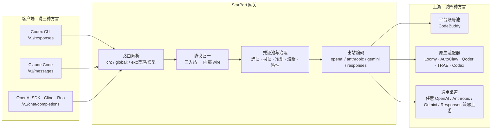

<h1 align="center">StarPort 星港</h1>

<p align="center">
  <b>多平台 AI 凭证网关：一个端点，统一三种协议与多家平台的模型访问</b><br>
  OpenAI Chat Completions · Anthropic Messages · OpenAI Responses 三面入站 ｜ 凭证池 · 协议转换 · 路由 · 用量治理
</p>

<p align="center">
  <a href="README.en.md">English</a> ｜ 简体中文
</p>

<p align="center">
  
  
  
  
  
</p>

---

## 30 秒速览

| 维度 | 内容 |
|---|---|
| **是什么** | 自托管网关：把客户端说的三种协议翻译成上游说的四种协议，并把多家平台的凭证收进一个池子统一治理 |
| **解决什么** | 工具与供给的协议不匹配 + 凭证分散。换后端只改一个 `model` 名——不重装工具、不改代码、不记第二套密钥 |
| **覆盖** | 3 种入站协议 × 4 种出站协议 × 8 个原生平台 + 任意自定义上游 |
| **规模** | 282 个 Go 文件 / 约 8.8 万行 · 142 个测试文件 · CI 跑 `go vet` + `go test` · MIT |
| **不做什么** | 不转售 API、不做多租户 SaaS、不提供账号共享 |

## 为什么存在这个项目

AI 编程工具的**协议面**正在分裂：Codex CLI 走 OpenAI Responses API，Claude Code 走 Anthropic Messages API，而绝大多数 SDK、IDE 插件、自研脚本走 Chat Completions。与此同时，模型**供给**又散落在多个平台上，每个平台有独立的登录方式、额度体系、限流规则和凭证格式。

结果是：开发者要维护 N 份客户端配置、N 套凭证、N 个用量视图，每换一个工具就重接一次线；想比较两个后端在同一任务上的表现，得来回改环境变量。

StarPort 把这件事收敛成两层：

- **协议层**：三个入站面（Chat Completions / Messages / Responses）→ 一个内部 wire → 四种出站协议。客户端说什么方言都行，上游说什么方言也都行。
- **凭证层**：多家平台账号 → 统一凭证池（健康状态、冷却、轮换、计量）→ 统一路由与配额视图。

一句话：**它是 AI 开发工作流里的一块连接件**——不生产模型，只负责让"工具"和"供给"对得上。

具体一点：同一台机器上 Codex CLI、Claude Code、Cline 可以同时在线，指向同一个本地端点；想换后端只改一个 model 名，不用重装工具、不用改代码、不用记第二套密钥。

## 它是什么 / 不是什么

| 是 | 不是 |
|---|---|
| 自托管、单二进制的协议网关 | API 转售平台 / 计费中转 |
| 三种入站协议的双向转换层 | 多租户 SaaS |
| 多平台凭证池与治理层 | 模型供应商 |
| 带 Web 面板的可观测运维工具 | 账号共享池 / 卡密分发 |

设计上刻意收窄：默认只监听 `127.0.0.1`、默认不含任何遥测、凭证只落本地文件（0600）。它服务的是"一个开发者管理自己的多个凭证"这个场景。

## 为什么它对生态重要（而不是又一个聚合器）

聚合器把流量导给某一家；中间件解决的是"谁都能接"的问题。这个仓库真正交出去的是三样可复用的公共资产：

1. **跨平台契约文档**：[docs/PLATFORMS.md](docs/PLATFORMS.md) 把 8 家平台的鉴权头形态、错误码语义、流式边界与已知坑整理成一张可对照的表。这类信息通常散落在各项目的私有笔记里，公开的系统性整理很少见。
2. **协议一致性测试模式**：三入站 × 四出站 × 各适配器的组合断言，加上"面板与后端平台注册表必须对齐"的 parity 门禁——新增平台漏改前端或漏注册，CI 直接红。这是一套可被同类项目直接抄走的工程约束。
3. **Responses 入站面的完整实现**：事件骨架（`response.created` → `output_item.*` → `response.completed`）、扁平工具声明、错误信封都按官方序列实现并覆盖测试。Responses 是相对新的一层协议面，公开的完整服务端实现并不多。

项目仍在早期，采用以自托管为主；这里不宣称任何未经验证的用户数或下载量。

## 适合谁

- 同时在两个以上 AI 编程工具之间切换的独立开发者
- 想把多个平台额度收拢到一个端点、统一看用量的小团队
- 需要在自建 harness 里对比多家后端表现的评测与研究场景

## 架构



三条设计原则：

1. **入站协议是视图，不是分支**：三个面都折成同一条 OpenAI Chat Completions wire 进调度，响应再实时折回客户端方言。治理逻辑（重试、换证、粘性、计量）只有一份。
2. **协议与平台正交**：`protocol` 决定报文形态，`adapter` 决定平台契约（鉴权头、请求形态、字段白名单）。同一份报文既能发普通上游，也能发要求"同一 session 出现在两个头里"的客户端类平台。
3. **配置即 API**：所有能力都通过 `config.json` 表达，面板只是它的编辑器。没有隐藏状态机，备份 = 两个目录 + 一个文件。

## 核心能力

**协议兼容**

- 三入站协议面：`/v1/chat/completions`、`/v1/messages`、`/v1/responses`，流式与非流式都覆盖
- 双向转换保语义：`system` / `tools` / `tool_use` / `tool_result` / `stop_reason` / `usage` 都能折回；Responses 面按官方事件序列输出（`response.created` → `output_item.*` → `response.completed`）
- **工具调用还原**：上游在丢失 `tools` 声明时会把工具调用以文本标记混进正文（客户端因此一次工具都不执行）；网关识别并还原为结构化 `tool_calls`
- **思维链与推理档位**：`reasoning_content` 多轮回填、effort 档位按上游实际支持面自动降级、`/v1/models` 透出真实可选档位
- SSE 帧按规范重建，不把整包 JSON 伪装成流式（宁可直接报错，也不污染客户端的 TTFT/吞吐观测）

**凭证治理**

- 账号池调度：按实测成本分层 → 快过期额度加权 → 比例 + 闲置补偿加权随机，Top-5 短名单防惊群
- 熔断与冷却：429 指数退避软冷却、402 硬冷却到次日、404 短冷却、连续失败熔断、在途租约限流；模型级限流只冷却该模型而非罚整号
- 会话粘性：同一会话绑定同一凭证（TTL 滚动续期、失败解绑、可镜像 Redis）
- 渠道凭证池：每渠道 ≤20 条凭证，429 只冷却该条并自动换下一条重试，401/403 标记失效退出轮换，全部不可用返回 `503 all_credentials_unavailable`
- 定时保号：签到、活跃上报、token 保活、连登兑换等多类动作独立开关，幂等可重跑

**可观测与运维**

- Web 面板 8 个视图：账号中心、用量、积分构成、任务中心、模型与档位、API 密钥、配置、运行日志
- 请求级日志：模型、状态码、账号指纹（前 8 位）、TTFB、token 速率，**不含任何凭证明文**
- 用量账本：按账号 / 模型 / 渠道 / 域聚合，积分扣除历史
- 接入密钥分离：可创建仅限 `/v1/*` 的 agent 密钥（存储只留 SHA-256 摘要，全钥仅创建时可见一次）

**安全**

- 出站 SSRF 校验（启动与保存双期）：拒绝内网 / 链路本地 / CGNAT / 云元数据字面地址
- 密钥回显哨兵：任何接口与日志都不出现凭证明文，保存时按 (渠道名, 凭证 label) 回填
- XFF 信任边界：默认从不采信 `X-Forwarded-For`，仅当直连地址落在可信反代白名单内才读取
- 面板与 API 统一 CSP（`default-src 'none'`）、`nosniff`、`X-Frame-Options: DENY`

## 平台支持

八种原生平台（有专属适配器）+ 通用渠道（配置即接入）。**新增普通平台不需要写 Go 代码**。

| 平台 | 路由前缀 | 登录方式 | 保号 | 刷新 | 余额 | 状态 |
|---|---|---|---|---|---|---|
| **CodeBuddy**（WorkBuddy） | 裸名 / `cn:` / `global:` | OAuth 设备授权 | ✅ 六类任务 | 重新登录 | ✅ | 稳定 |
| **Loomy**（讯飞） | `ext:loomy/` | 粘贴 session | ✅ 每日积分 | — | ✅ | 可用 |
| **AutoClaw 国内**（智谱） | `ext:autoclaw/` | 手机号 + 短信 | ✅ | ✅ | ✅ | 可用 |
| **AutoClaw 国际** | `ext:autoclaw-intl/` | OAuth + 滑块 | ✅ | ✅ | ✅ | 可用 |
| **Qoder 国内**（阿里） | `ext:qoder/` | PKCE 设备码 | ✅ | ✅ | ✅ | 可用 |
| **Qoder 国际** | `ext:qoder-intl/` | PKCE 设备码 | 平台无活动 | ✅ | ✅ | 可用 |
| **TRAE**（字节 · SOLO 国内） | `ext:trae/` | PKCE 回环回调 | ⏳ 契约就位 | ⏳ | ⏳ | 转发 + 登录可用 |
| **Codex**（ChatGPT 订阅） | `ext:codex/` | 粘贴 `auth.json`（渠道向导） | — | ⚠️ 未验收 | — | 实验性 |
| **通用平台**（custom） | `ext:c-<id>/` | 粘贴 `base_url` + secret | — | — | — | 可用 |

> ⏳ = 实现与契约测试已就位，等待真实账号验收后一次性打开；⚠️ = 契约来自公开参考实现，未用真实账号联调，失败会在面板台账显式报错（可观测，不静默）。
> 各平台的鉴权头、请求形态、错误码与已知边界见 **[docs/PLATFORMS.md](docs/PLATFORMS.md)**。

## 协议与模型路由

**入站端点**

| 端点 | 鉴权 | 说明 |
|---|---|---|
| `POST /v1/chat/completions` | Bearer | OpenAI 兼容补全，流式 / 非流式 |
| `POST /v1/messages` | Bearer | Anthropic Messages 面（Claude Code 主入口） |
| `POST /v1/responses` | Bearer | OpenAI Responses 面（Codex CLI 主入口） |
| `GET /v1/models` | Bearer | 模型目录，附上下文长度、输出上限、推理档位、渠道来源 |
| `GET /status` | Bearer | 池状态、凭证健康、按模型聚合的限流视图 |
| `GET /healthz` | 无 | 健康检查（带 `service: "starport"` 标识） |

**模型名即路由**

| 形态 | 解析 | 去向 |
|---|---|---|
| `deepseek-v4-flash` | 裸名 | CodeBuddy 账号池（realm=`cn`） |
| `global:gpt-5` | `global:` 前缀 | CodeBuddy 账号池（realm=`global`） |
| `cn:glm-5` | `cn:` 前缀 | CodeBuddy 账号池（realm=`cn`） |
| `ext:qoder/glm-5.3` | `ext:<渠道>/<模型>` | 指定渠道，走该渠道的协议与凭证池 |
| `ext:codex/gpt-5.1-codex` | 同上 | Codex 订阅后端 |
| 渠道别名 | `ext:<渠道>/<别名>` | 映射到上游真实模型名 |

`/v1/messages` 与 `/v1/responses` 对非 `ext:` 模型回退主池——同一个自建端点可以同时服务 Claude Code 与 Codex CLI，客户端侧不需要任何改造。

## 快速开始

**准备**：Docker（或直接跑单文件二进制）；从源码构建需要 Go ≥ 1.22。

### 方式一：Docker

```bash
mkdir -p auths data && cp config.example.json config.json   # 建议先编辑 api_key，或留空自动生成

docker run -d --name starport \
  -p 127.0.0.1:7863:7863 -e TZ=Asia/Shanghai -e STARPORT_LISTEN=0.0.0.0:7863 \
  -v ./auths:/app/auths -v ./data:/app/data -v ./config.json:/app/config.json \
  ghcr.io/risinginsight/startport:latest

curl -s http://localhost:7863/healthz
```

### 方式二：Docker Compose

```bash
git clone https://github.com/RisingInsight/startport.git && cd startport
cp config.example.json config.json
docker compose up -d --build
```

### 方式三：单文件二进制

```powershell
go build -trimpath -ldflags="-s -w" -o starport.exe ./cmd/server
.\starport.exe                    # 启动服务并自动打开面板
.\starport.exe -open=false        # 不自动开浏览器
```

前端资源已嵌入二进制，拷到任意机器可跑，只需 `auths/` 与 `data/` 可写。

### 验证

```bash
curl -s http://localhost:7863/v1/models -H "Authorization: Bearer your-api-key"
curl -sN http://localhost:7863/v1/chat/completions \
  -H "Authorization: Bearer your-api-key" -H "Content-Type: application/json" \
  -d '{"model":"deepseek-v4-flash","messages":[{"role":"user","content":"hi"}],"stream":true}'
```

## 客户端接入

面板（`http://127.0.0.1:7863/startport/`）里创建一把 **agent 密钥**（只开放 `/v1/*`），然后：

**OpenAI SDK / 任意 OpenAI 兼容客户端**

```python
from openai import OpenAI
client = OpenAI(base_url="http://127.0.0.1:7863/v1", api_key="sp-...")
```

**Claude Code**（走 `/v1/messages`）

```bash
export ANTHROPIC_BASE_URL=http://127.0.0.1:7863
export ANTHROPIC_AUTH_TOKEN=sp-...
```

**Codex CLI**（走 `/v1/responses`，`~/.codex/config.toml`）

```toml
model = "ext:qoder/glm-5.3"
model_provider = "starport"

[model_providers.starport]
name = "StarPort"
base_url = "http://127.0.0.1:7863/v1"
env_key = "STARPORT_API_KEY"
wire_api = "responses"
```

> 字段名随 Codex CLI 版本演进，请以你本机 `codex --version` 对应文档为准；网关侧只需要一个能返回 Responses 事件流的 `POST /v1/responses`。
> 把 `model` 换成 `ext:autoclaw/...` 或裸名，同一个客户端就能在多家后端之间切换——这正是本项目想解决的问题。

## Web 面板

`http://127.0.0.1:7863/startport/`（明暗主题，8 个视图）

| 视图 | 内容 |
|---|---|
| **账号中心** | 统一账号视图（可用率 / 在途 / 今日签到）、按平台分池、账号详情抽屉、添加账号（浏览器登录或粘贴凭证）、签到与刷新 |
| **用量** | Token 时序、按账号 / 模型 / 域 / 渠道的明细、积分扣除历史 |
| **积分构成** | 额度到期分布、账号对比、逐包明细 |
| **任务中心** | 全账号成长任务扫描与执行队列 |
| **模型与档位** | 上游实时模型目录（含外部渠道模型）、生效价与牌价、推理档位、上下文与输出上限 |
| **API 密钥** | agent 密钥创建与吊销 |
| **配置** | 在线编辑 `config.json`，热生效字段立即应用 |
| **运行日志** | 请求记录（模型 / 账号 / 来源 IP·UA / 耗时 / token / 请求 ID）+ 分频道运行日志 |

渠道设置是独立抽屉：渠道卡片 + 凭证列表 + 新建向导，23 个平台预设可一键生成草稿（`base_url` 永远留空，凭证必须你自己填）。

## 配置

`config.example.json` 是最完整的字段参考。核心字段：

| 字段 | 默认 | 说明 |
|---|---|---|
| `listen` | `127.0.0.1:7863` | 监听地址；对外暴露需改 `0.0.0.0` 并**必须设强 `api_key`** |
| `api_key` | 空 | 管理密钥（面板 + 全部接口）；空 = 不鉴权 |
| `auth_dir` / `state_file` | `./auths` / `./data/state.json` | 凭证目录 / 池状态 |
| `server.max_body_mb` | `0` | 入站请求体上限（MiB），`0` 不限制 |
| `server.trusted_proxies` | `[]` | 可信反代网段；空 = 从不采信 `X-Forwarded-For` |
| `pool.max_in_flight` / `max_in_flight_global` | `3` / `2` | 单账号在途上限 |
| `pool.breaker_threshold` / `breaker_cooldown` | `3` / `30m` | 连败熔断阈值与退避 |
| `cooldown.soft_rate` / `soft_rate_max` | `600s` / `2h` | 429 软冷却基数与封顶 |
| `session_sticky.enabled` / `ttl` | `true` / `30m` | 会话粘性 |
| `prompt.mode` | `custom` | 提示词策略（`custom` / `append` / `passthrough`） |
| `upstream.timeout_seconds` | `120` | 上游短 RPC 超时（聊天按首字节 / 空闲分段计时，长思考不掐断） |
| `upstash.url` / `token` | 空 | Redis 镜像（可选），粘性绑定与池状态防重启丢失 |
| `ext_channels[]` | `[]` | 外部渠道：`name` / `base_url` / `protocol` / `adapter` / `auth` / `headers` / `models` / `aliases` / `credentials[]` / `allow_private` |
| `logging.request_archive_enabled` | `true` | 请求元数据归档（不含提示词、响应正文与凭证） |

环境变量 `STARPORT_*` 在 JSON 之后加载（非空才覆盖），完整清单见 `cmd/server/config.go`。

## 安全模型

- **凭证**：`auths/*.json` 为明文 token，0600 原子写回；`.gitignore` 已排除 `auths/`、`data/`、`config.json`
- **网络**：默认仅回环监听；无内置 TLS，公网必须强 `api_key` + HTTPS 反代；启动期拒绝弱口令
- **日志**：stdout 与 JSONL 归档均不含 token / api_key 明文，不读取 `Authorization` 头
- **鉴权实现**：SHA-256 摘要 + 常量时间比较；agent 密钥与管理密钥分离；`uid` 白名单校验防路径穿越
- **出站 SSRF**：只做字面判定不解析 DNS（避免 TOCTOU），`allow_private` 可显式放行自建内网聚合器
- **发布完整性**：镜像与二进制均由 CI 从源码构建，无第三方预编译产物

## 工程状态

这些数字可以用 `git` 与 `go test` 直接复核，不是宣传口径：

| 指标 | 数值 |
|---|---|
| Go 源码 | 282 个文件 / 约 87,800 行 |
| 测试 | 142 个测试文件 / 约 37,900 行（覆盖率以 `go test -cover` 为准） |
| 当前状态 | `go build ./...` / `go vet ./...` / `go test ./...` 全绿（2026-10-21 本地实跑） |
| CI | PR 与 main 上跑 `go vet` + `go test`，并做五平台交叉编译 |
| 发布 | `v*` tag 触发多平台产物 + checksums，`latest` / `main` / `sha-*` 镜像 tag |
| 上游同步 | 定期与活跃上游分支合并，冲突解完跑全量验证后合回 |

## 路线图

按"从个人工具到通用中间件"的路径推进，每项都有明确验收标准：

**近期（v1.9）**
- **协议一致性矩阵**：把「三入站 × 四出站 × 各适配器」的组合固化成表驱动测试（当前分散在各包单测里，新增协议面容易漏组合）
- TRAE 保号第二批：真实账号验收通过后一次性打开签到 / 刷新 / 余额
- `go test -cover` 纳入 CI 门禁，覆盖率基线落盘防回退

**中期**
- **适配器清单化**：把平台契约从 Go 代码抽成声明式 manifest（鉴权头模板、字段白名单、错误码映射），新增平台从"改 5 处代码"降到"加一个 YAML"
- **配置体验**：渠道向导支持导入/导出、批量凭证管理、配置 diff 与回滚
- **可观测性**：Prometheus `/metrics`、按渠道的长期用量落盘（当前凭证级计数为进程内）

**长期**
- **与 Codex CLI / Claude Code 的更深集成**：一条命令生成客户端配置（`starport init codex`），自动写 `config.toml` 与密钥，免手工拼 base_url
- **协议面补齐**：`input_image` 跨协议转码、Responses 的 `previous_response_id` 会话存储（可选后端）
- **社区化**：贡献指南、适配器模板仓库、good-first-issue 清单、公开的兼容性矩阵

目标不是做成又一个"多模型聚合站"，而是做成**社区驱动的、解决跨平台 AI 工具碎片化问题的开源基础设施**：协议转换与凭证治理应该是可复用、可审计、可自托管的公共件。

## 项目沿革

| 阶段 | 仓库 | 状态 |
|---|---|---|
| 起源 | [Sliverkiss/workbuddy2api](https://github.com/Sliverkiss/workbuddy2api) | 已不可公开访问 |
| 活跃分支 | [linguo2625469/workbuddy2api-panel](https://github.com/linguo2625469/workbuddy2api-panel) | 社区维护中，本仓库同步基准 |
| 本项目 | **StarPort** | 在其基础上重构为多平台网关，并保持定期同步 |

相对上游，本仓库的增量集中在：外部渠道框架（多协议 / 多凭证池）、三个原生平台适配器族、账号中心、Responses 入站面、agent 密钥分离、SSRF 与 XFF 边界、版本检查。详见 `deliverables/` 下的设计记录。

## 使用边界

本项目只适合一个用途：**管理你自己的账号与凭证**——给自己的工具接一个私有入口，把分散的凭证收拢到一处。

明确反对的行为：面向公众的 API 售卖与账号池出租；批量注册小号刷额度；任何"收费版 / 卡密版"分发（本项目永远免费，收费分发版无法审计，存在窃取你明文凭证的风险）。

MIT 协议赋予的是代码层面的自由，不赋予以本项目名义宣传售卖或要求作者背书的权利。

## 免责声明

本项目仅供学习与研究。使用需遵守各上游平台的服务条款，账号封禁、条款违约等风险自负；作者不对使用本项目产生的任何直接或间接损失负责。本项目不授予任何上游接口或服务的权利。

## License

[MIT](LICENSE)。再分发时请保留原始出处 Sliverkiss/workbuddy2api 的版权与许可声明。
